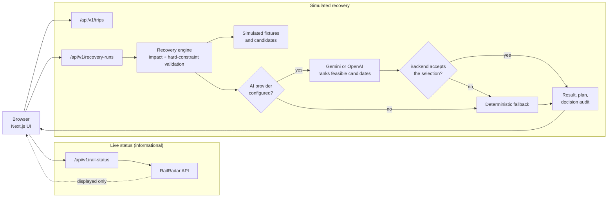

# Sutra - Team Vyom

> **When travel breaks, Sutra repairs the journey.**

Sutra is a rail-first travel-disruption recovery prototype for DevHack 2026, **PS 4.1 - AI Agent for Travel Disruption Recovery**. It traces how a disruption spreads through a connected itinerary, validates simulated recovery options against traveller constraints in backend code, and returns a repaired plan with its trade-offs. AI can help choose among options that are already feasible; it does not decide feasibility.

**[Live deployment](https://sutra-five-opal.vercel.app)** · **[Source code](https://github.com/KevalXD/Sutra)**

## Contents

- [Overview](#overview)
- [Problem](#problem)
- [Current capabilities](#current-capabilities)
- [How the recovery workflow works](#how-the-recovery-workflow-works)
- [What is live and what is simulated](#what-is-live-and-what-is-simulated)
- [Architecture](#architecture)
- [Technology stack](#technology-stack)
- [Live deployment](#live-deployment)
- [Run locally](#run-locally)
- [Environment variables](#environment-variables)
- [Testing and validation](#testing-and-validation)
- [Current limitations](#current-limitations)
- [Team and project details](#team-and-project-details)

## Overview

Sutra combines three things in one Next.js application:

1. A **recovery workbench** where a traveller picks a simulated journey and disruption, sets constraints, and gets validated recovery options.
2. A **backend recovery engine** that analyses impact, checks every candidate against hard constraints, and produces an auditable result.
3. A **manual live railway-status lookup** (RailRadar) that shows a train's reported running status. It is informational and is kept separate from the recovery engine.

## Problem

A train delay or cancellation rarely affects a single ticket. It can break an onward connection, push the arrival past a deadline, and ripple into later commitments such as an activity or a hotel check-in. A replacement can look attractive and still exceed the budget, miss the deadline, or require overnight travel. Travellers need recovery planned against the **whole journey**, with the trade-offs visible.

## Current capabilities

- **Recovery workbench** (`/workbench`): choose one of five simulated journeys and a supported disruption, set the arrival deadline, extra-budget limit, no-overnight rule and a priority (lower cost or earlier arrival), then run recovery.
- **Configurable disruptions:** delay profiles accept 30–180 minutes in 30-minute steps; cancellation profiles are fixed. Details are in the [journey API contract](docs/CONFIGURABLE_JOURNEY_API_CONTRACT.md).
- **Connected-itinerary validation:** candidates are checked for connections, location continuity, time windows and temporal dependencies between bookings, including activities and hotels where a journey has them.
- **Backend decision audit:** every recovered or no-feasible response carries the effective constraints, the decision source and each candidate's checked rules and violations. The UI renders this audit instead of guessing feasibility locally.
- **Optional AI recommendations:** server-side Gemini or OpenAI adapters rank only candidates that already passed validation. The backend then checks the AI's selection and its claims itself.
- **Deterministic fallback:** when AI is not configured, unavailable, times out or returns something the backend rejects, a deterministic ranking is used and the response says so (`decisionSource: "DETERMINISTIC_FALLBACK"`).
- **Distinct outcomes:** `RECOVERED`, `NO_FEASIBLE_RECOVERY` and `TECHNICAL_ERROR` are separate states, each with its own presentation.
- **Traveller control:** proposed actions are marked `"automated": false`. Sutra does not book, cancel, pay or refund.
- **Guided demo** (`/demo?scenario=…`): four deterministic scenarios on the golden Mangaluru Central → Hassan Junction → Mysuru Junction trip.
- **Live rail status:** a manual **Check live status** control for a five-digit train number, available when `RAILRADAR_API_KEY` is configured on the server.

## How the recovery workflow works

1. **Select** a simulated journey and a disruption profile, and set traveller constraints.
2. **Analyse impact:** identify the disrupted booking and the bookings that depend on it.
3. **Generate candidates:** fixture-owned, simulated alternatives for that disruption.
4. **Validate:** check each candidate against the arrival deadline, extra budget, overnight rule and booking dependencies. Candidates that fail are kept with their violations and are never recommended.
5. **Recommend:**
   - If an AI provider is configured, it receives only feasible candidates and returns a structured selection. The backend validates the choice, and the explanation shown to the traveller is generated from verified data.
   - Otherwise, or if the AI step fails or is rejected, the engine ranks feasible candidates deterministically (lowest extra cost by default, earliest arrival when that priority is chosen).
6. **Return** the result, recovery plan, proposed actions and decision audit for the traveller to review.

If no candidate is feasible, Sutra returns `NO_FEASIBLE_RECOVERY` with the violated constraints and proposes no actions. A recommendation is labelled `AI` only after independent validation.

## What is live and what is simulated

| Area | Status |
| --- | --- |
| Train running status (workbench **Check live status**) | **Live and manual.** One request to RailRadar per click, through Sutra's server. Informational only. It does not change recovery candidates, feasibility or ranking. |
| Journeys, bookings, disruptions | **Simulated** fixtures. |
| Replacement candidates, times and costs | **Simulated** fixtures. |
| Feasibility validation and decision audit | **Real backend logic** applied to the simulated data. |
| AI recommendation | **Real provider call** when configured and valid; otherwise deterministic fallback. |
| Ticket availability, fares, PNR, booking | **Not implemented.** |

## Architecture



The frontend and the API routes are one Next.js application deployed together. Live status reaches the UI for display only; no edge connects it to the recovery engine. In AI-required mode (see [Environment variables](#environment-variables)) a rejected or unavailable AI result returns a `TECHNICAL_ERROR` (`AI_UNAVAILABLE`) instead of using the fallback.

`sutra-backend-skeleton/` is retained as a separate reference implementation. The application does not import it; its unit tests are included in `npm run test`.

**API routes**

| Route | Purpose |
| --- | --- |
| `GET /api/v1/trips` | Catalogue of simulated journeys and supported disruption profiles |
| `GET /api/v1/trips/:tripId` | Canonical simulated trip; `404` if unknown |
| `POST /api/v1/recovery-runs` | Run a simulated recovery (request shape in the [API contract](docs/CONFIGURABLE_JOURNEY_API_CONTRACT.md)) |
| `GET /api/v1/rail-status?trainNumber=NNNNN` | Validated RailRadar running status for a five-digit train number |

**Pages:** `/` (home), `/how-it-works`, `/workbench`, `/demo?scenario=delay|cancellation|infeasible|error`.

## Technology stack

| Area | Technologies |
| --- | --- |
| Framework | Next.js 15 (App Router, Route Handlers), React 19, TypeScript 5 |
| 3D and UI | Three.js, React Three Fiber, Drei, Tailwind CSS 4, Lucide React, Motion; Inter, Instrument Sans and IBM Plex Mono through `next/font/google` |
| Recovery engine | TypeScript domain logic over simulated fixtures |
| Optional AI | Google Gemini (`@google/genai`); OpenAI adapter calling the Responses API with `fetch` |
| Live status | RailRadar REST API, called server-side with `fetch` |
| Quality | Node.js test runner with `tsx`, `tsc --noEmit`, ESLint; optional Playwright scripts in [`qa/`](qa/README.md) |
| Hosting | Vercel |

Versions follow `package.json`.

## Live deployment

**<https://sutra-five-opal.vercel.app>**

| Page | URL |
| --- | --- |
| Workbench | <https://sutra-five-opal.vercel.app/workbench> |
| Demo scenarios | `/demo?scenario=delay`, `cancellation`, `infeasible`, `error` |

Which AI and RailRadar settings the hosted instance uses is a deployment configuration that this repository cannot show, so the behaviour of that instance may differ from a default local run.

## Run locally

**Requirements:** Node.js 20 LTS recommended (Next.js 15 requires 18.18 or newer), npm, and internet access on first build/run for Google Fonts.

```bash
git clone https://github.com/KevalXD/Sutra.git
cd Sutra
npm ci
npm run dev
```

Open <http://localhost:3000>, then try `/workbench` or `/demo?scenario=delay`. With no `.env.local`, the app runs with deterministic fallback and live status shows as not configured.

To serve a production build locally:

```bash
npm run build
npm run start
```

## Environment variables

Optional configuration lives in `.env.local`, which is git-ignored. Never commit keys, and never prefix them with `NEXT_PUBLIC_`; all of them are read server-side only.

```bash
cp .env.example .env.local
```

```powershell
Copy-Item .env.example .env.local
```

> **Default local behaviour:** `.env.example` sets `SUTRA_AI_REQUIRED=false`. You can copy it without adding an AI key; recovery then uses deterministic fallback when Gemini is not configured or unavailable. Set `SUTRA_AI_REQUIRED=true` only when you want fail-closed Gemini behaviour.

| Variable | In `.env.example` | Behaviour |
| --- | --- | --- |
| `SUTRA_AI_PROVIDER` | `gemini` | `auto`, `gemini` or `openai`. Unset or `auto` prefers Gemini when `GEMINI_API_KEY` is set, otherwise OpenAI when `OPENAI_API_KEY` is set. |
| `GEMINI_API_KEY` | empty | Enables the Gemini adapter. |
| `SUTRA_GEMINI_MODEL` | `gemini-3.6-flash` | Gemini model. Optional mode defaults to `gemini-3.6-flash` when unset; AI-required mode needs it set explicitly. |
| `SUTRA_AI_REQUIRED` | `false` | Default is `false` when unset. When `true`, Sutra is fail-closed: it requires Gemini (OpenAI is rejected), a key and an explicit model, and returns `AI_UNAVAILABLE` instead of a deterministic result if the validated recommendation is missing. |
| `RAILRADAR_API_KEY` | empty | Enables the workbench live-status lookup. Without it the lookup reports that live status is not configured. |
| `OPENAI_API_KEY` | not listed | Enables the OpenAI adapter. Supported in code. |
| `SUTRA_OPENAI_MODEL` | not listed | OpenAI model. Defaults to `gpt-4o-mini`. |

Provider selection is fixed per run: there is no runtime switch from a failing provider to the other one. To see the effective settings without printing key values:

```bash
npm run ai:config
```

Live status is fetched only when the user clicks **Check live status**: there is no polling or background refresh. The server-side RailRadar request uses a 120-second revalidation setting, and the response keeps RailRadar's own `lastUpdatedAt`. Errors are shown as unavailable and are not replaced with fixture data.

## Testing and validation

Run from the repository root:

```bash
npm run test
npm run typecheck
npm run lint
npm run build
```

| Script | Purpose |
| --- | --- |
| `npm run test` | Node test runner via `tsx`: engine, AI-provider, API-route, rail-status and UI suites, plus the skeleton's domain tests |
| `npm run typecheck` | `tsc --noEmit` |
| `npm run lint` | ESLint |
| `npm run build` | Next.js production build (fetches Google Fonts) |
| `npm run ai:config` | Print effective AI configuration without exposing keys |
| `npm run test:ai:smoke` | Opt-in check against a real Gemini key; not part of `npm run test` |

**Last verified run (21 October 2026, local `K:\sutra` working copy on Node.js v24.16.0):** `npm run test` ran 131 tests, all passing; `npm run typecheck`, `npm run lint`, and `npm run build` completed successfully. The production build fetched Google Fonts successfully in this environment.

Optional Playwright browser checks are described in [`qa/README.md`](qa/README.md).

## Current limitations

- Live railway status is informational. It does not drive, recalculate or rank recovery alternatives.
- Journeys, bookings, disruptions and recovery alternatives are simulated. Sutra does not monitor live delays or cancellations and does not detect disruptions on its own.
- No live ticket availability, live fares, PNR verification or automatic booking, cancellation, payment or refund.
- No user accounts or persistent trip storage.
- The AI only ranks candidates the backend has already found feasible, and it is not a source of railway facts. A live AI recommendation depends on provider availability and a response the backend accepts; otherwise the deterministic fallback applies (or `AI_UNAVAILABLE` in AI-required mode).
- Live status depends on a RailRadar key and the provider's quota and availability.

## Team and project details

**Team Vyom** - Mangalore Institute of Technology and Engineering (MITE)

- Mayank M Kamath - Team leader
- Nithesh
- Likhith M Jogi
- Keval R Jain

**Event:** DevHack 2026 · **Problem statement:** PS 4.1 - AI Agent for Travel Disruption Recovery

Further material: [journey API contract](docs/CONFIGURABLE_JOURNEY_API_CONTRACT.md), [planning documents](docs/planning/README.md), [implementation notes](IMPLEMENTATION_NOTES.md). Released under the [MIT License](LICENSE).
