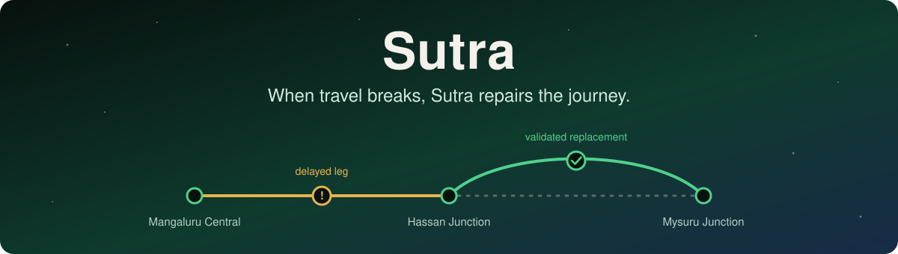
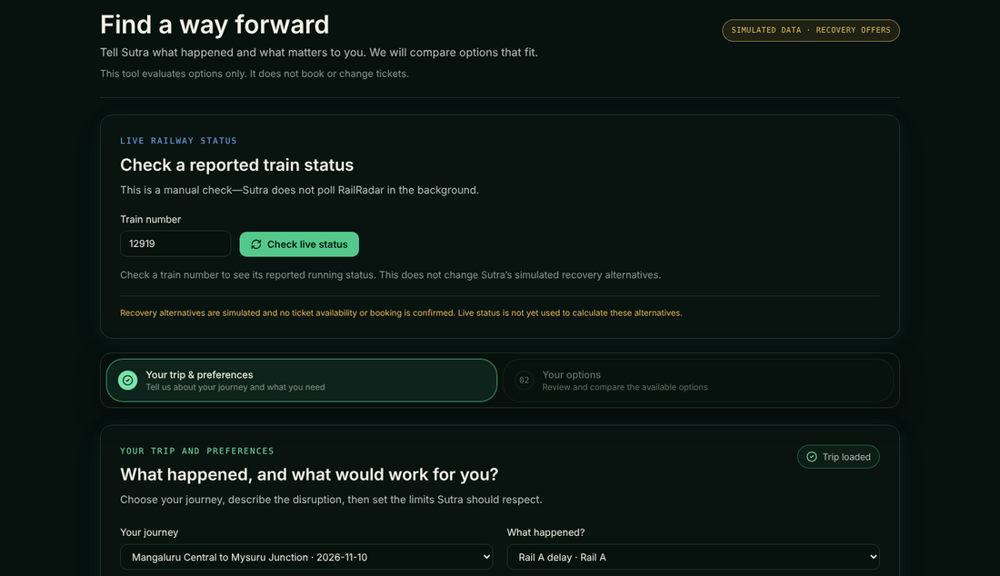
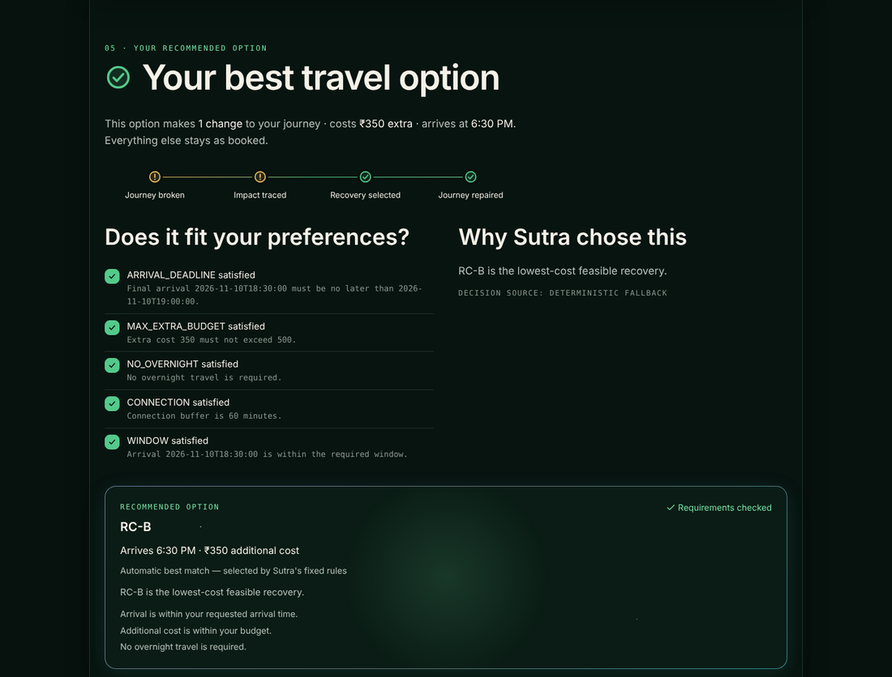
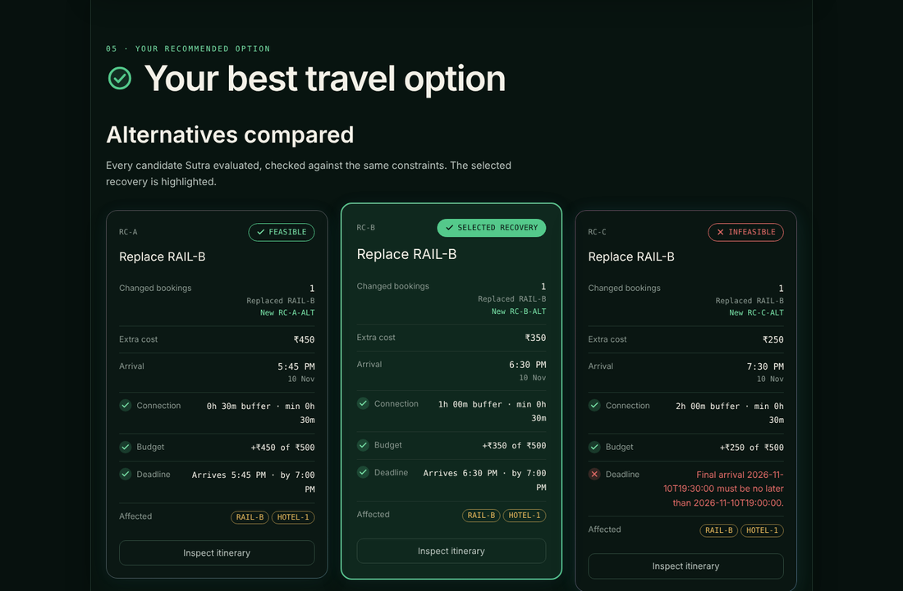
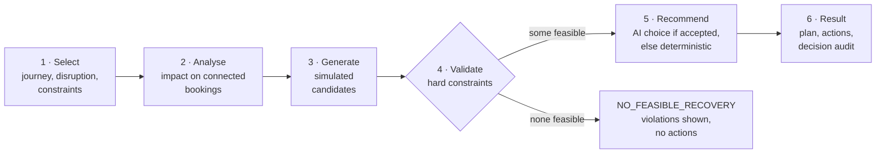
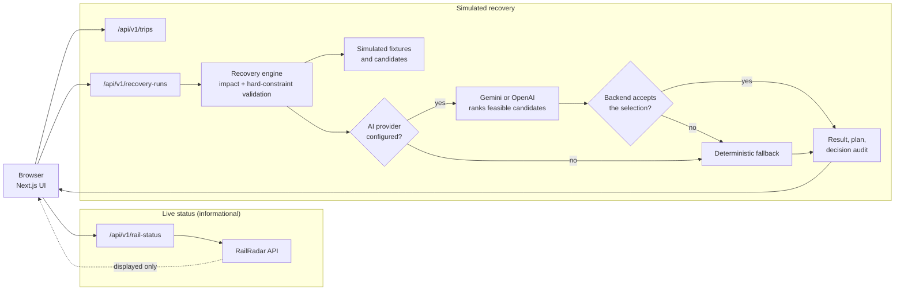

<div align="center">



<br>

**A rail-first travel-disruption recovery prototype.**<br>
Sutra traces how a disruption spreads through a connected journey, validates simulated recovery options in backend code, and returns a repaired plan with its trade-offs. AI can help choose between options that are already feasible. It never decides what is feasible.

<br>

[](https://sutra-five-opal.vercel.app)
&nbsp;
[](https://github.com/KevalXD/Sutra)

<br>


**DevHack 2026 · PS 4.1 — AI Agent for Travel Disruption Recovery · Team Vyom**

[Preview](#product-preview) · [What it does](#what-sutra-does) · [How it works](#how-it-works) · [Architecture](#architecture) · [Live vs simulated](#live-versus-simulated) · [Quick start](#quick-start) · [Developer docs](#developer-documentation) · [Limitations](#limitations)

</div>

---

> [!NOTE]
> All journeys, bookings, disruptions and recovery alternatives are **simulated**. Sutra does not book, cancel, pay or refund, and it does not check live ticket availability or fares.

## Product preview

Real screenshots of the running application, captured from a local run of this repository with no AI key configured, so the recommendation shown is the deterministic fallback. Journeys and replacement options are simulated.

<p align="center">
  
  <br>
  <sub><b>Recovery workbench.</b> Pick a simulated journey and disruption, then set the traveller's limits. The live train-status check is separate and says it does not change recovery alternatives.</sub>
</p>

<table>
  <tr>
    <td width="50%" valign="top">
      
      <br>
      <sub><b>Result with a decision audit.</b> Each constraint is shown with its outcome, and the decision source is stated.</sub>
    </td>
    <td width="50%" valign="top">
      
      <br>
      <sub><b>Every candidate, checked.</b> Candidates that break a constraint are shown as infeasible, with the reason.</sub>
    </td>
  </tr>
</table>

## What Sutra does

<table>
  <tr>
    <td width="50%" valign="top">
      <h4>Journey recovery</h4>
      A disruption on one leg is traced through the connected itinerary, including later bookings such as an activity or a hotel. Recovery is planned for the whole journey, not one ticket.
    </td>
    <td width="50%" valign="top">
      <h4>Backend constraint validation</h4>
      Every candidate is checked against the arrival deadline, extra budget, overnight rule and booking dependencies. A candidate that fails is kept with its violations and is never recommended.
    </td>
  </tr>
  <tr>
    <td width="50%" valign="top">
      <h4>Optional AI recommendations</h4>
      With a Gemini or OpenAI key configured on the server, the AI ranks only candidates that already passed validation. The backend then checks the AI's selection and its claims before it is shown.
    </td>
    <td width="50%" valign="top">
      <h4>Deterministic fallback</h4>
      If AI is not configured, is unavailable, or its result is rejected, a deterministic ranking is used and the response says so. Strict deployments can instead fail closed with <code>AI_UNAVAILABLE</code>.
    </td>
  </tr>
</table>

Also included: a guided demo of four scenarios, five simulated journeys in the workbench, a backend-authored decision audit, and a manual live train-status lookup. Proposed actions always carry `"automated": false`.

## How it works



Three outcomes are kept distinct: `RECOVERED`, `NO_FEASIBLE_RECOVERY` and `TECHNICAL_ERROR`. A recommendation is labelled `AI` only after the backend has independently validated it.

## Architecture



The frontend and API routes are a single Next.js application deployed together. Live status reaches the UI **for display only**; no path connects it to the recovery engine. In AI-required mode, a rejected or unavailable AI result returns a `TECHNICAL_ERROR` (`AI_UNAVAILABLE`) instead of using the fallback.

`sutra-backend-skeleton/` is a separate reference implementation. The application does not import it; its unit tests run as part of `npm run test`.

## Live versus simulated

| | Live | Simulated | Not implemented |
| --- | --- | --- | --- |
| **What** | Train running status from RailRadar, fetched manually | Journeys, bookings, disruptions, replacement candidates, times and costs | Live ticket availability, live fares, PNR verification, booking, cancellation, payment, refunds |
| **How it behaves** | One server-side request per click on **Check live status** | Fixture data owned by the application | — |
| **Role in recovery** | **None.** Informational only; it does not drive, recalculate or rank alternatives | The only input to the recovery engine | — |

Real logic runs on the simulated data: impact analysis, constraint validation, the decision audit, and the AI-or-fallback recommendation.

> [!IMPORTANT]
> Live railway status does **not** currently feed the recovery engine. Recovery alternatives are not generated from live railway availability.

## Quick start

**Requirements:** Node.js 20 LTS recommended (Next.js 15 requires 18.18 or newer), npm, and internet access on first run for Google Fonts.

```bash
git clone https://github.com/KevalXD/Sutra.git
cd Sutra
npm ci
npm run dev
```

Open <http://localhost:3000>, then try:

- `/workbench`: configure a simulated journey and run recovery
- `/demo?scenario=delay` (also `cancellation`, `infeasible`, `error`): the guided demo on the Mangaluru Central → Hassan Junction → Mysuru Junction trip
- `/how-it-works`: a plain-language overview

No API keys are needed. Without them, recovery uses the deterministic fallback and the live-status control reports that it is not configured. To try AI or live status, see **Environment variables** under [Developer documentation](#developer-documentation).

## Validation status

| Check | Result on 21 October 2026 |
| --- | --- |
| Automated tests | 131 passed |
| Type checking | Passed |
| Lint | Passed |
| Production build | Passed |

These are results from the submission validation run, not a guarantee for later commits. Re-run the commands under **Testing and validation** in [Developer documentation](#developer-documentation) after any change.

## Developer documentation

<details>
<summary><b>Environment variables</b></summary>

<br>

Optional configuration lives in `.env.local`, which is git-ignored. Never commit keys and never prefix them with `NEXT_PUBLIC_`; all of them are read server-side only.

```bash
cp .env.example .env.local
```

```powershell
Copy-Item .env.example .env.local
```

`.env.example` sets `SUTRA_AI_REQUIRED=false`, so it can be copied as-is without any key.

| Variable | In `.env.example` | Behaviour |
| --- | --- | --- |
| `SUTRA_AI_PROVIDER` | `gemini` | `auto`, `gemini` or `openai`. Unset or `auto` prefers Gemini when `GEMINI_API_KEY` is set, otherwise OpenAI when `OPENAI_API_KEY` is set. |
| `GEMINI_API_KEY` | empty | Enables the Gemini adapter. |
| `SUTRA_GEMINI_MODEL` | `gemini-3.6-flash` | Gemini model. Optional mode defaults to `gemini-3.6-flash` when unset; AI-required mode needs it set explicitly. |
| `SUTRA_AI_REQUIRED` | `false` | Defaults to `false` when unset. See fail-closed behaviour below. |
| `RAILRADAR_API_KEY` | empty | Enables **Check live status** in the workbench. Without it the lookup reports that live status is not configured. |
| `OPENAI_API_KEY` | not listed | Enables the OpenAI adapter. Supported in code. |
| `SUTRA_OPENAI_MODEL` | not listed | OpenAI model. Defaults to `gpt-4o-mini`. |

To print the effective settings without exposing key values:

```bash
npm run ai:config
```

</details>

<details>
<summary><b>AI provider configuration and behaviour</b></summary>

<br>

- **Selection is fixed per run.** One provider is chosen from the environment. There is no runtime switch from a failing provider to the other one.
- **What the provider sees.** Only candidates that already passed validation. It returns a structured selection, and the backend independently checks the chosen candidate and the provider's claims. The explanation shown to the traveller is generated from verified data.
- **Optional mode (default).** A missing key, provider error, timeout, malformed output or rejected recommendation falls back to deterministic ranking: lowest extra cost by default, earliest arrival when that priority is chosen. The response reports `decisionSource: "DETERMINISTIC_FALLBACK"`.
- **AI-required mode (`SUTRA_AI_REQUIRED=true`).** Fail-closed. It requires Gemini (selecting OpenAI is rejected), a key and an explicitly set `SUTRA_GEMINI_MODEL`. If a validated recommendation is missing, the run returns `TECHNICAL_ERROR` with code `AI_UNAVAILABLE` rather than a deterministic result.
- **Secrets.** Keys are read only in server code and are not included in browser bundles or API responses.
- **Opt-in real-provider check.** `npm run test:ai:smoke` runs recovery through the same provider selection against a real Gemini key. It is separate from `npm run test`.

</details>

<details>
<summary><b>API routes</b></summary>

<br>

| Route | Purpose |
| --- | --- |
| `GET /api/v1/trips` | Catalogue of simulated journeys and their supported disruption profiles |
| `GET /api/v1/trips/:tripId` | Canonical simulated trip; `404` if unknown |
| `POST /api/v1/recovery-runs` | Run a simulated recovery |
| `GET /api/v1/rail-status?trainNumber=NNNNN` | Validated RailRadar running status for a five-digit train number |

**Pages:** `/`, `/how-it-works`, `/workbench`, `/demo?scenario=delay|cancellation|infeasible|error`.

**Example recovery request**

```json
{
  "tripId": "trip-golden-rail-delay-01",
  "tripVersion": 1,
  "disruption": {
    "source": "SIMULATED",
    "scenarioId": "golden-rail-delay-01",
    "bookingId": "RAIL-A",
    "kind": "delay",
    "delayMinutes": 120
  },
  "constraintOverrides": { "maxExtraBudget": 500, "noOvernight": true, "priority": "LOWER_COST" }
}
```

Delay profiles accept 30 to 180 minutes in 30-minute steps. `constraintOverrides` is optional and accepts `latestArrivalAt`, `maxExtraBudget`, `noOvernight` and `priority` (`LOWER_COST` or `EARLIER_ARRIVAL`).

**Responses.** `RECOVERED` and `NO_FEASIBLE_RECOVERY` return `200` and include a backend-authored `decisionAudit`. Invalid input returns `400`, an unknown trip or booking `404`, a stale `tripVersion` `409`, and other rejected input `422`. A technical failure returns `500` with `status: "TECHNICAL_ERROR"`.

**Live status.** `/api/v1/rail-status` is called only when the user clicks **Check live status**. There is no polling or background refresh. The server-side request uses a 120-second revalidation setting, the response keeps RailRadar's own `lastUpdatedAt`, and failures are shown as unavailable rather than replaced with fixture data.

Full contract: [`docs/CONFIGURABLE_JOURNEY_API_CONTRACT.md`](docs/CONFIGURABLE_JOURNEY_API_CONTRACT.md).

</details>

<details>
<summary><b>Technology stack</b></summary>

<br>

| Area | Technologies |
| --- | --- |
| Framework | Next.js 15 (App Router, Route Handlers), React 19, TypeScript 5 |
| 3D and UI | Three.js, React Three Fiber, Drei, Tailwind CSS 4, Lucide React, Motion; Inter, Instrument Sans and IBM Plex Mono through `next/font/google` |
| Recovery engine | TypeScript domain logic over simulated fixtures |
| Optional AI | Google Gemini (`@google/genai`); OpenAI adapter calling the Responses API with `fetch` |
| Live status | RailRadar REST API, called server-side with `fetch` |
| Quality | Node.js test runner with `tsx`, `tsc --noEmit`, ESLint; optional Playwright scripts in [`qa/`](qa/README.md) |
| Hosting | Vercel |

Versions follow `package.json`.

</details>

<details>
<summary><b>Testing and validation</b></summary>

<br>

Run from the repository root:

```bash
npm run test
npm run typecheck
npm run lint
npm run build
```

| Script | Purpose |
| --- | --- |
| `npm run test` | Node test runner via `tsx`: engine, AI-provider, API-route, rail-status and UI suites, plus the skeleton's domain tests |
| `npm run typecheck` | `tsc --noEmit` |
| `npm run lint` | ESLint |
| `npm run build` | Next.js production build (fetches Google Fonts) |
| `npm run start` | Serve the production build locally after building |
| `npm run ai:config` | Print effective AI configuration without exposing keys |
| `npm run test:ai:smoke` | Opt-in check against a real Gemini key; not part of `npm run test` |

Optional Playwright browser checks (end-to-end scenarios, responsive layout, accessibility and focus) are described in [`qa/README.md`](qa/README.md).

</details>

<details>
<summary><b>Repository layout and further documentation</b></summary>

<br>

| Path | Contents |
| --- | --- |
| `app/` | App Router pages and the `/api/v1` route handlers |
| `components/sutra/` | UI components, including the workbench and the 3D globe |
| `lib/recovery/` | Recovery engine, request handling, provider selection and the Gemini and OpenAI adapters |
| `lib/integrations/` | Server-side RailRadar adapter and its validated public shape |
| `lib/domain/` | Domain types and the simulated trip and scenario fixtures |
| `tests/` | Node test-runner suites |
| `qa/` | Optional Playwright checks |
| `scripts/` | AI configuration and smoke-test scripts, and the globe texture build tooling |
| `sutra-backend-skeleton/` | Separate reference implementation, not used by the application |

Further reading: [journey API contract](docs/CONFIGURABLE_JOURNEY_API_CONTRACT.md) · [product and UI specs](docs/spec/) · [planning documents](docs/planning/README.md) · [implementation notes](IMPLEMENTATION_NOTES.md)

</details>

## Limitations

> [!WARNING]
> Sutra is a hackathon prototype, not an operational railway-recovery service.

- Live railway status is informational. It does not drive, recalculate or rank recovery alternatives.
- Journeys, bookings, disruptions and recovery alternatives are simulated. Sutra does not detect or monitor disruptions on its own.
- No live ticket availability, live fares or PNR verification.
- No automatic booking, cancellation, payment or refund. Proposed actions are for the traveller to review.
- No user accounts or persistent trip storage.
- Not every recommendation is AI-generated. The AI only ranks candidates the backend has already found feasible, and it is not a source of railway facts. If it is unavailable or its result is rejected, the deterministic fallback applies, or `AI_UNAVAILABLE` in AI-required mode.
- Live status depends on a RailRadar key and the provider's availability and quota.

## Team and event

**Team Vyom** · Mangalore Institute of Technology and Engineering (MITE)

Nithesh · Mayank M Kamath · Likhith M Jogi · Keval R Jain

**DevHack 2026** · Problem statement **PS 4.1 — AI Agent for Travel Disruption Recovery**

Released under the [MIT License](LICENSE).
